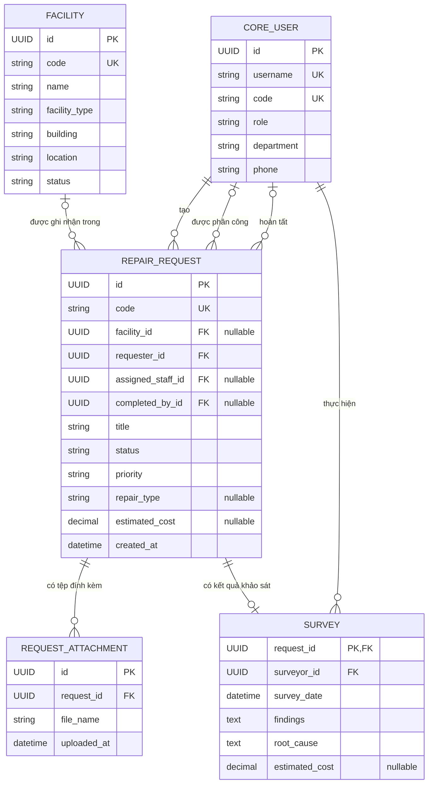
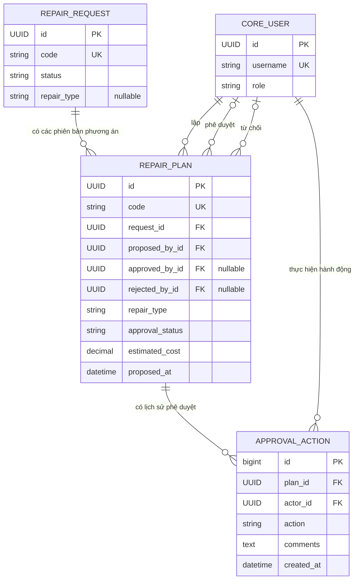
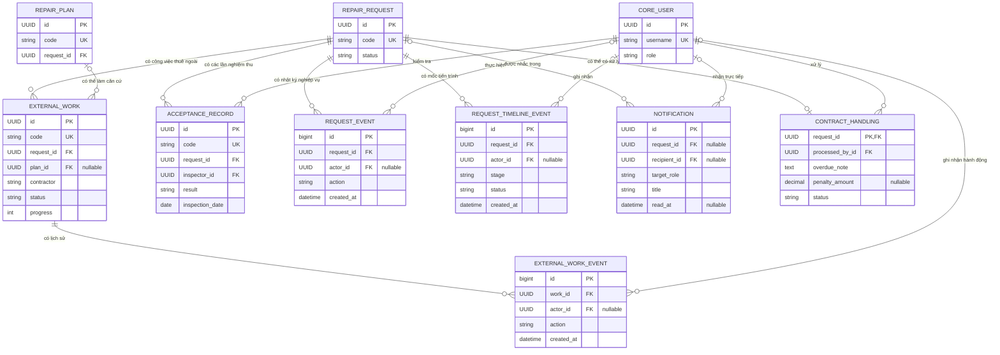
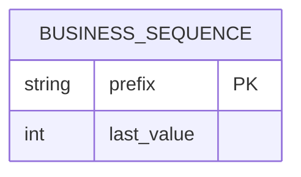

# ERD cơ sở dữ liệu hệ thống quản lý sửa chữa CSVC

Tài liệu này mô tả schema Django hiện tại, sau khi áp dụng các migration trong `backend/core/migrations/`. Đây là ERD của backend đang chạy, không phải sơ đồ khái niệm đã giản lược hay một thiết kế giả định.

Các sơ đồ được chia theo nhóm nghiệp vụ để dễ đọc. Những entity `REPAIR_REQUEST` và `CORE_USER` xuất hiện lại ở nhiều sơ đồ chỉ là điểm nối để chia hình, không phải các bảng khác nhau.

Để sơ đồ dễ đọc, mỗi entity chỉ liệt kê khóa chính, khóa ngoại và các trường tiêu biểu; định nghĩa đầy đủ tất cả cột nằm trong `backend/core/models.py`.

## 1. Người dùng, cơ sở vật chất và yêu cầu

### Ý nghĩa quan hệ

- Một yêu cầu thuộc đúng một người yêu cầu; người dùng có thể tạo nhiều yêu cầu.
- Yêu cầu có thể chưa gắn một cơ sở vật chất trong danh mục. Khi đã gắn, mỗi yêu cầu chỉ tham chiếu một cơ sở.
- Cán bộ phụ trách và người hoàn tất là các quan hệ tùy chọn tới `CORE_USER`.
- `SURVEY.request_id` đồng thời là khóa chính và khóa ngoại: mỗi yêu cầu có tối đa một bản khảo sát hiện hành; mỗi bản khảo sát thuộc đúng một yêu cầu.
- Yêu cầu có thể có nhiều bản ghi tệp đính kèm. Model hiện lưu tên tệp, không lưu nội dung tệp hoặc đường dẫn lưu trữ.

## 2. Phương án và phê duyệt

Một yêu cầu có thể có nhiều phương án vì phương án bị từ chối vẫn được lưu để bảo toàn lịch sử; phương án lập lại là bản ghi mới. `approval_status` trên phương án thể hiện trạng thái hiện tại, còn `APPROVAL_ACTION` ghi lại từng hành động phê duyệt/từ chối.

Luồng nghiệp vụ hiện tại: cán bộ phụ trách khảo sát; Quản trị CSVC lập phương án; phương án cần phê duyệt được Ban Giám hiệu duyệt hoặc từ chối. Vai trò được lưu ở trường `CORE_USER.role` dưới dạng lựa chọn cố định, không phải bảng riêng.

## 3. Thuê ngoài, nghiệm thu, lịch sử và xử lý hợp đồng

### Các quy tắc cần lưu ý

- Một công việc thuê ngoài thuộc đúng một yêu cầu; có thể liên kết tới một phương án. Khi có `plan_id`, database bảo đảm không tạo hai công việc cho cùng cặp yêu cầu/phương án. Database hiện chưa có ràng buộc bảo đảm phương án đó cũng thuộc cùng yêu cầu; API tạo dữ liệu theo đúng yêu cầu này.
- Một yêu cầu có thể có nhiều lần nghiệm thu, nhật ký sự kiện và mốc tiến trình.
- `REQUEST_EVENT` là nhật ký hành động; `REQUEST_TIMELINE_EVENT` là các mốc tiến trình được chọn để hiển thị. Một hành động có thể tạo cả hai loại bản ghi.
- Thông báo có thể nhắm tới một vai trò, một người nhận cụ thể, một yêu cầu, hoặc kết hợp các đích này. Các khóa người nhận và yêu cầu là tùy chọn.
- `CONTRACT_HANDLING.request_id` là khóa chính đồng thời khóa ngoại, vì vậy mỗi yêu cầu có tối đa một hồ sơ xử lý hợp đồng hiện hành.

## 4. Bảng mã nghiệp vụ và bảng hệ thống

`BUSINESS_SEQUENCE` cấp mã như yêu cầu, phương án, thuê ngoài và nghiệm thu; bảng này độc lập, không có khóa ngoại nghiệp vụ.

Các bảng nhóm/quyền và phiên đăng nhập của Django không được vẽ trong ERD nghiệp vụ. Schema backend hiện hỗ trợ SQLite mặc định và PostgreSQL khi cấu hình `DATABASE_URL`.

## Ghi chú thiết kế

- `CORE_USER.role`, trạng thái, mức ưu tiên và loại sửa chữa là các lựa chọn enum trong model Django; không có bảng danh mục vai trò/trạng thái riêng.
- `REPAIR_REQUEST` lưu thêm một số snapshot như mã/tên/loại cơ sở, tên người yêu cầu, phòng ban và thông tin liên hệ. Các snapshot giúp giữ nội dung yêu cầu tại thời điểm gửi, kể cả khi hồ sơ cơ sở hoặc thông tin người dùng được cập nhật sau đó.
- `REPAIR_REQUEST` cũng giữ trạng thái tổng hợp và một số trường tiến độ hiện hành để phục vụ danh sách/luồng xử lý. `SURVEY`, `REPAIR_PLAN`, `EXTERNAL_WORK` và `ACCEPTANCE_RECORD` lưu chi tiết từng phần nghiệp vụ; đây là dữ liệu tổng hợp phục vụ luồng ứng dụng, không phải các quan hệ bảng độc lập.
- Quy tắc giá trị không âm cho chi phí, giới hạn tiến độ 0–100 và thời lượng khắc phục dương được kiểm tra ở database, ngoài kiểm tra đầu vào của API.
- Khóa ngoại dùng `PROTECT`, `SET_NULL` hoặc `CASCADE` tùy vai trò dữ liệu: giữ lại người dùng có tham chiếu nghiệp vụ; giữ bản ghi nghiệp vụ khi một số tác nhân bị xóa; xóa dữ liệu con thuộc sở hữu yêu cầu/phương án khi bản ghi cha bị xóa.

## Nguồn schema

- Model: `backend/core/models.py`
- Migration ban đầu và các thay đổi: `backend/core/migrations/`
- Cấu hình database: `backend/config/settings.py`
